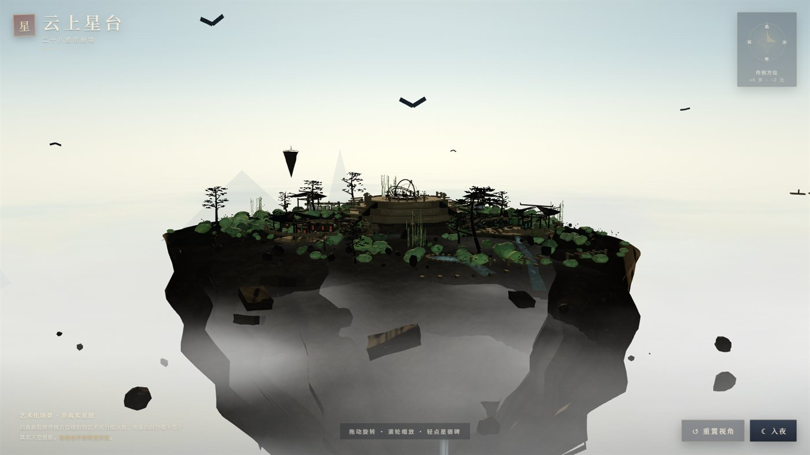
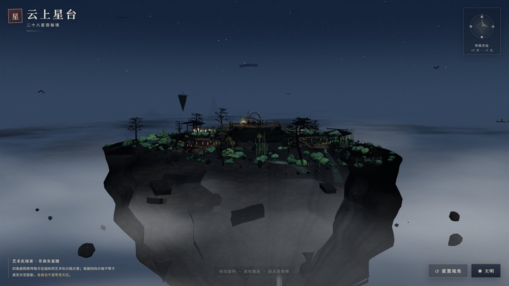
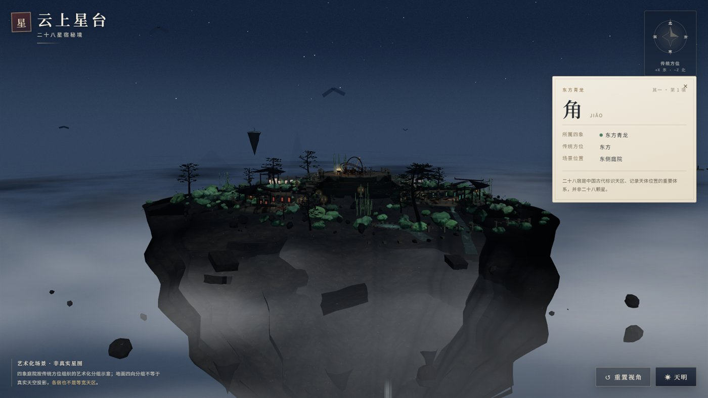
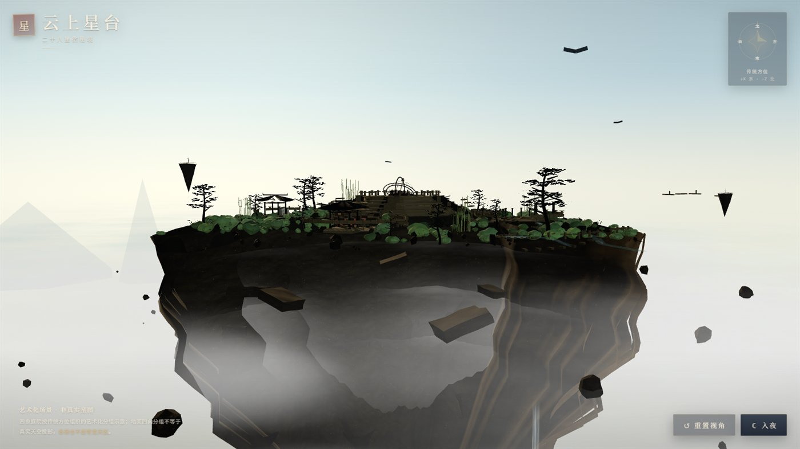

# 云上星台——二十八星宿秘境 · 交互式 3D 场景

单文件 Three.js 幻想场景：一座浮在云海之上的古山岛，正中是阶梯式青铜浑仪观星台，四周是按艺术化方位划分的四组院落（东青龙、北玄武、西白虎、南朱雀），每院落 7 座星宿碑，共 28 枚。白天／夜晚双模式平滑过渡，可旋转、缩放、重置视角，点击碑牌弹出对应宿位的说明卡。




| 点击碑牌弹出信息卡 | 旋转视角后的岛底与瀑布 |
|---|---|
|  |  |

> **艺术化场景，非真实星图。** 装饰是艺术造型，并非真实星图、真实古迹或占卜内容。二十八宿是中国古代标识天区、记录天体位置的重要体系，**并非二十八颗星**。四院分组依传统方位布置，是分组示意，并非天空投影，各宿所占宽度也不等于天区等分扇区。

## 1. 启动

**在线访问**：<https://zzx20051016-lang.github.io/star-terrace-3d/>

**本地运行**（无需联网，Three.js 已内置在 `vendor/`）：

```bash
git clone https://github.com/zzx20051016-lang/star-terrace-3d.git
cd star-terrace-3d

# 任选其一：
node scripts/serve.mjs                    # 默认端口 8177
node scripts/serve.mjs 8080               # 指定端口
```

访问 `http://localhost:8177/`。也可以直接用 `python -m http.server 8177` 等任意静态服务器，但**不要用 `file://` 直接打开**——ES Module 会被 CORS 拦截。

> 只需看效果、不改代码的话，`index.html` 是已构建好的单文件；`vendor/` 必须与它同级。

## 2. 交互

| 操作 | 行为 |
|---|---|
| 鼠标拖拽 | 旋转视角 |
| 滚轮 | 缩放 |
| 右键拖拽 | 平移 |
| 点击碑牌 | 弹出该宿信息卡（宿名 / 四象 / 拼音 / 方位 / 场景位置 / 简介） |
| 点信息卡外侧 | 关闭卡片 |
| 「重置视角」 | 平滑回到初始 HOME 视角 |
| 「入夜／天明」 | 在 2.5 秒内平滑切换昼夜 |

镜头有距离和极角限制，不会翻到地下或贴近星体。

## 3. 工程结构

```
star-terrace-3d/
├── index.html                 # 构建产物（单文件，含全部 CSS + JS，可直接访问）
├── vendor/three@0.164.1/      # 内置 Three.js（build + OrbitControls + BufferGeometryUtils），离线可用
├── docs/                      # README 配图（压缩后 JPG）
├── src/
│   ├── template.html          # UI 骨架（导入映射、CSS、品牌栏、罗盘、提示、按钮、信息卡）
│   └── js/
│       ├── 00-core.js         # 固定种子 RNG、值噪声、fbm、世界常量、HOME 视角
│       ├── 01-materials.js    # Canvas 程序纹理、withSurfaceDetail / withWind 材质扩展
│       ├── 02-terrain.js      # 浮岛顶面、岛缘、主岩体、悬垂岩柱、悬空碎石、远浮岛、残桥、岩层板
│       ├── 03-path.js         # 路径曲面、栏杆、踏步、广场草地与灌木 InstancedMesh
│       ├── 04-observatory.js  # 三层台基、楼层镶嵌、方位牌、浑仪基座与三环、铜鼎
│       ├── 05-courtyard.js    # 弧形屋顶、亭、影壁、祭坛、28 座碑、门、灯笼
│       ├── 06-vegetation.js   # 松、竹、灌木、叶片风动 shader、雾松
│       ├── 07-water.js        # 水面 shader、瀑布、瀑布雾、飞沫粒子、庭院水渠与水池
│       ├── 08-sky.js          # 云海多层 shader + 远景云团 sprite、远山、天空穹顶、星空、日月光、鸟
│       ├── 09-daynight.js     # 灯光、雾、天空、云、自发光、灯笼的统一过渡
│       ├── 10-interaction.js  # 射线拾取、信息卡、重置视角补间、响应式 resize
│       └── 11-animate.js       # 主循环、浑仪自转、水/风/云/星空时间、鸟翅、品质自适应
├── scripts/
│   ├── build.mjs              # 把 src/template.html + src/js/*.js 拼成 index.html
│   ├── serve.mjs              # 静态服务器
│   └── check.mjs              # 无头 Chrome (CDP) 自动化检查：BOOT / 截图 / 点击 / 切夜 / 重置 / 旋转 / 窄屏
└── previews/                  # 自动检查截图（本地生成，未纳入版本控制）
```

`★ Insight ─────────────────────────────────────`
- **构建**：12 个 ES Module 通过 `<script type="module">` 合并为一段内联脚本（保留 `import` 兼容性），仅 Three.js 与 OrbitControls 走 CDN importmap，开发时改 `src/js/*.js` 后跑 `node scripts/build.mjs`。
- **渲染**：WebGL2 + ACESFilmic + PCFSoftShadow，pixelRatio 上限 1.75；着色器扩展用 `onBeforeCompile` 注入世界空间 fbm 噪声，不增加 draw call。
- **资源**：零外部图片/字体/模型；所有纹理都是程序绘制（`CanvasTexture`），所有几何由代码生成。
`─────────────────────────────────────────`

## 4. 程序建模与材质方案

### 4.1 地形（src/js/02-terrain.js）

- `terrainHeight(x,z)` 用值噪声 fbm2 控制顶面高低，并对四个院落方向做不同高度的目标值平滑（东 1.55、北 0.75、西 1.15、南 0.92；观星台基座外圈 `smoothstep(14.2, 18.8)` 整平）。
- 主岩体径向网格 176×40，由 17 帧 `ROCK_PROFILE` 控制上下轮廓，叠加 `buttress(theta)` 垂直脊与 `noise(theta*46, t*2.2)` 垂直沟壑。
- 每个经度有独立 `depth(62 + n1·14 + n2·7)` 与底部 `leanDir` 偏移，做出"挂壁"而非对称圆锥。
- 岛缘断面 160×8 网格从顶部土壤渐变到岩层，再用 `root = pow(vnoise(θ·41, t·3), 4) * 0.35` 混入草根暗条纹。
- 远浮岛 4 座（−92/16/−46、82/6/−86、−58/−12/98、112/−16/36），带残桥连接；22 块悬空碎石沿岛缘分布。

### 4.2 观星台（src/js/04-observatory.js）

- 三层台基半径 13.0 / 10.5 / 8.2，高 1.24 / 1.26 / 1.34，整平区在 r≈14.2 外侧才开始抬升，与台阶和栏杆对齐。
- 顶层地砖镶嵌 8 个方位符号（青/玄/白/朱 + 中央），方向牌四面环绕。
- 浑仪三环半径 3.55 / 3.08 / 2.62，由 64 段 CircleGeometry + 自转惯量构成；外环带旋转黄道刻度纹理。

### 4.3 28 座碑（src/js/05-courtyard.js）

- 每院落外半径 9.4 的圆周上放 7 座碑，间距均匀但角度方向略加随机，避免对称感。
- 碑身高 1.7 m，宽 0.6 m，碑额为院专属图案（角线龙 / 玄线龟蛇 / 白线虎 / 朱线鸟），全部用 Canvas 绘制。
- 碑文由 `makeSteleTexture` 程序绘制：宿名（篆体笔意）+ 拼音 + 序号 + 简介。

### 4.4 材质（src/js/01-materials.js）

- `withSurfaceDetail(mat, opts)` 通过 `onBeforeCompile` 给 `MeshStandardMaterial` 注入 `colorJitter / strata / wet / grainRough / sparkle` 五类世界空间 fbm 噪声，调整每片石头纹理差异。
- `withWind(mat, opts)` 给树叶/草叶加顶点风动位移。
- 全部纹理走 `CanvasTexture`，重复平铺，无外部资源。

### 4.5 水（src/js/07-water.js）

- 自定义 ShaderMaterial：UV 流速 + 折射项 + 高光项 + 法线扰动；庭院水渠/水池、瀑布水流与池底波纹共用 shader。
- 瀑布为两层：宽 3 m、高 64 m 的主瀑与宽 1.25 m、高 48 m 的侧瀑；末端接 16 m 直径的 `makeWaterfallMist` 雾团和 260 颗 Additive 飞沫粒子。

### 4.6 云与天空（src/js/08-sky.js）

- 四层 shader 平面（y = −54 / −36 / −22 / −8），半径 720–1500，叠 64 颗近景云团 sprite。
- 天空为反向法线球 + `ShaderMaterial`（三色渐变 + 日轮软斑 + uNight 暗化）。
- 1500 颗 Points 星空（`sizeAttenuation` + twinkle）、9 只鸟（翅膀拍动）、140 只萤火虫（夜间显示）。

### 4.7 昼夜（src/js/09-daynight.js）

- `DAY` / `NIGHT` 两个参数对象，`setNightTarget(on)` 在 2.5 秒内用 `lerp` 插值。
- 影响：天空顶/中/地三色、雾色与密度、key/fill/hemi/ambient 四光强与色温、自发光材质（`APP.emissiveMats`）、灯笼 sprite 不透明度、青苔/窗格/铜鼎自发光、星空透明度、云海色调与不透明度、瀑布雾、远山、水渠色温。

## 5. 技术要点

- **单文件交付**：`scripts/build.mjs` 把 `src/template.html` 与 12 个模块按序拼接，`index.html` 自包含全部 CSS 与 JS（约 203 KB）。
- **完全离线**：Three.js 0.164.1 内置在 `vendor/`，通过 importmap 以相对路径引入，不依赖任何 CDN。已在断网条件下实测可启动（见 §8）。
- **零外部资源**：所有纹理由 `CanvasTexture` 现场绘制，所有几何由代码生成；中文使用系统字体，无字体下载。
- **确定性**：固定随机种子 `0x5eed2a17` + `rngFor(salt)` 独立随机流，新增装饰不会打乱既有布局，刷新后场景完全一致。
- **材质扩展**：`onBeforeCompile` 注入世界空间 fbm 噪声（色斑 / 岩层 / 湿润 / 颗粒粗糙 / 闪点）与顶点风动，不增加额外 draw call。
- **性能取舍**：`InstancedMesh` 承载草叶、灌木、松针、竹叶、萤火虫；`pixelRatio` 上限 1.75；运行中按帧率自动降级。
- **自动部署**：`.github/workflows/pages.yml` 在每次 push 到 `main` 时组装站点并发布到 GitHub Pages。

## 6. 已知视觉局限（三项主要）

| # | 局限 | 现象 | 影响 |
|---|---|---|---|
| 1 | 远山为扁圆锥体 MeshBasic | 远景层叠的山影在平视下边缘清晰、缺少体积层次 | 镜头拉远到云海上方时显得像"剪纸山" |
| 2 | 瀑布落入云层靠雾团接续 | 末段是 additive 雾 + 飞沫粒子，并非真实水流物理 | 喷出方向固定，不能随风变化 |
| 3 | 远浮岛与残桥分辨率较低 | 远距 4 座浮岛只有 ~300 三角形整体剪影 | 拉近时细节不足，难以看清碑与亭 |

## 7. 自检清单（运行时）

- 初始构图完整：HOME 视角能看到观星台、四院落轮廓、云海、瀑布。
- 四组各七宿、不重复、不漏名（28 / 28）。
- 中文无错字（"二十八宿是中国古代标识天区、记录天体位置的重要体系，并非二十八颗星。" 文案已显示）。
- 昼夜切换平滑（2.5 s 内完成 sky / fog / 灯 / 自发光 / 星空 / 云）。
- 旋转、缩放、重置均可用，无抖动或越界。
- 点击碑牌 → 信息卡内容正确；点击卡片外侧关闭。
- 瀑布与云海持续运动。
- 窗口缩放无溢出（最小 430 × 860 已验）。
- 控制台无报错，无网络请求失败。

## 8. 验证说明

以下检查均通过无头 Chrome（CDP 驱动）实际执行，不是估计值。

**功能检查**（`scripts/check.mjs`，6 项）：

| 项 | 结果 |
|---|---|
| 启动 | `ready: true`，`fatal: false` |
| 宿数 | 28 / 28，四组各七 |
| 信息卡 | 点击「角」→ 文本完整（宿名 / 四象 / 拼音 / 方位 / 场景位置 / 说明） |
| 昼夜切换 | 通过 |
| 重置视角 | 通过 |
| 旋转视角 | 通过 |
| 窄屏 430×860 | 无溢出 |
| 控制台 | 无报错、无失败请求 |

**离线检查**（`scripts/check-offline.mjs`）：在 CDP 层拦截全部非本机请求后重新加载，结果 `ready: true`、外部请求 0、失败请求 0 —— 完全断网可运行。

**未验证的部分**：无头 swiftshader 报告的 fps 仅为 0~1，**不能代表真实性能**；真实帧率与拖拽手感需在本地浏览器中评估。

## 9. 重做与修改

- 仅修改 `src/js/*.js` 后跑：

```bash
node scripts/build.mjs
```

`index.html` 即被重建；UI / CSS 在 `src/template.html`。

- 调试相机：`http://localhost:8177/?cam=78,16,108&target=0,-6,0&fov=42` 直接覆盖初始视角。
- 检查截图：

```bash
node scripts/check.mjs --url "http://127.0.0.1:8177/" --out previews/custom --width 1600 --height 900
node scripts/check.mjs --url "http://127.0.0.1:8177/" --out previews/custom --mode one   # 仅截一张
```

## 10. 许可

- 项目代码：MIT，见 [LICENSE](LICENSE)。
- 资源：零外部资源（无图、无模型、无字体下载、无第三方纹理）。
- 文本知识边界：参见本文开头的「艺术化场景」声明与碑牌卡片文案。